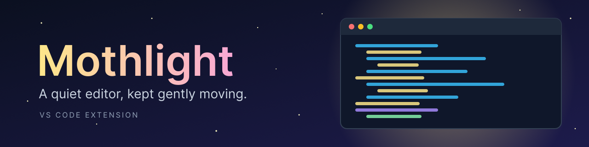

<p align="center">
  <picture>
    <source srcset="assets/banner.svg" type="image/svg+xml">
    
  </picture>
</p>

<p align="center">
  <a href="https://github.com/tickernelz/mothlight/actions/workflows/ci.yml"></a>
  
  
</p>

Mothlight keeps a quiet editor gently moving. After a minute without activity it drifts through read-only copies of your workspace files, scrolling and switching tabs. The first thing you do brings you back exactly where you were.

## Highlights

- **Your files stay untouched.** Every file is shown as a read-only copy, so nothing can be edited or saved by accident.
- **Gets out of the way.** Typing, clicking, scrolling, switching tabs or focusing the window ends the drift and restores your editor.
- **Careful about what it shows.** Environment files, keys and credentials are never opened, and neither are binaries, lock files or very large files.
- **Light.** One timer while watching and no polling. No network access, no telemetry, no child processes.

## Install

Build the package and install it:

```sh
npm ci
npm run package
code --install-extension mothlight-0.1.0.vsix
```

CI also uploads the packaged `.vsix` as a build artifact on every run.

## Use

A moon in the status bar shows that Mothlight is watching. Click it to turn Mothlight off and on. The command palette offers `Mothlight: Toggle`, `Mothlight: Start Now` and `Mothlight: Stop`.

## Documentation

- [How it works](docs/how-it-works.md)
- [Configuration](docs/configuration.md)
- [Development](docs/development.md)

## License

[MIT](LICENSE)
